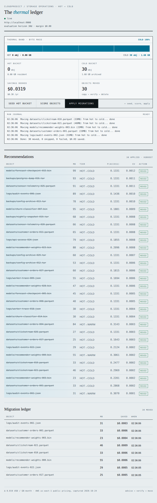

# cloudPredict

**Expected-value driven storage tiering.** cloudPredict predicts how likely each Object is to be read,
prices the move to a cheaper tier with a formal EV model, and — with your say-so — physically migrates
it from a hot bucket to a cold one, verifying every byte on the way.



## Why

Object storage bills by tier. Hot storage is expensive per GB-month; cold storage is cheap but charges
for retrieval. Time-based rules ("archive after 30 days idle") ignore whether an Object is *about to be
read*, and a single false eviction can wipe out months of savings.

cloudPredict scores every Object instead:

```
EV = P(inactive) × Storage_Savings − P(access) × Egress_Penalty      (ADR 0001)
```

An Object is recommended only when `EV > min_ev_margin` (default `0.00`). All money math is `Decimal`.

## How it works

- **Access Probability** comes from an XGBoost classifier (Random Forest as the comparison model)
  trained on a temporal split, with a decay-weighted frequency estimator as the heuristic baseline.
- **Six-rung benchmark**: no tiering · naive 30-day rule · decay heuristic · XGBoost · Random Forest ·
  Oracle. Every rung is priced through the same EV lens; the headline is **EV Capture** — each rung's
  total EV as a fraction of the Oracle's ceiling.
- **Execution layer**: copy to cold → verify the ETag matches the source → delete from hot → update
  SQLite → append to the migration ledger. The source is never deleted before the copy is verified.

## Architecture

```
                    ┌────────────────────┐   ┌─────────────────────┐
                    │ CLI (argparse)     │   │ Dashboard (FastAPI) │
                    │ generate/ingest/   │   │ status · seed ·     │
                    │ train/score/report │   │ score · apply (SSE) │
                    │ setup/seed/apply   │   └──────────┬──────────┘
                    └─────────┬──────────┘              │
                              │                         │
        ┌─────────────────────▼─────────────────────────▼──────────────┐
        │ domain/  (stdlib only, ADR 0002/0003)                        │
        │   FinOpsEngine · tier decisions · ports (Protocol)           │
        │   Object · AccessEvent · MigrationRecord                     │
        └───────────────┬──────────────────────────┬───────────────────┘
                        │                          │
        ┌───────────────▼────────────┐   ┌─────────▼──────────────────┐
        │ infrastructure/            │   │ infrastructure/            │
        │ SQLite repository (0005)   │   │ Silo adapter (boto3, S3)   │
        │ XGBoost / RF estimators    │   │ copy · head · delete       │
        └────────────────────────────┘   └────────────────────────────┘
```

## Install

```bash
uv sync --group dev
```

Requires Python 3.12+ and a local S3-compatible endpoint (Silo / MinIO) at `http://localhost:9000`.

Credentials come from the environment; local-demo defaults are `minioadmin` / `minioadmin`:

```bash
export CLOUDPREDICT_SILO_ENDPOINT=http://localhost:9000   # optional
export CLOUDPREDICT_SILO_ACCESS_KEY=minioadmin
export CLOUDPREDICT_SILO_SECRET_KEY=minioadmin
```

## Quick start (5-minute demo)

```bash
# 1. create buckets and verify access
uv run cloudpredict setup-minio

# 2. real files + deterministic access history
uv run cloudpredict seed-minio          # 30 objects, ~1.7 GB, ~10s

# 3. live control plane
uv run uvicorn cloudpredict.web.app:app --host 127.0.0.1 --port 8000
```

Open <http://localhost:8000>, then click **Seed hot bucket → Score objects → Apply migrations**.
Watch the files move, and verify them in the Silo console at <http://localhost:9001>.

Full click-by-click script: [DEMO.md](DEMO.md).

## CLI reference

| Command | What it does |
| --- | --- |
| `cloudpredict setup-minio` | Creates `hot` and `cold`, sets demo public-read, probes put/head/delete |
| `cloudpredict seed-minio` | Uploads 30 real files (20–100 MB) and seeds Zipfian access history |
| `cloudpredict apply [--dry-run]` | Scores, then copies → verifies ETag → deletes, ledgered and idempotent |
| `cloudpredict generate` | Synthetic 5,000-Object Zipfian log for the benchmark |
| `cloudpredict ingest` | Imports canonical CSV into SQLite |
| `cloudpredict train` | Trains XGBoost + Random Forest on the temporal split |
| `cloudpredict score` | Writes per-Object EV recommendations |
| `cloudpredict report` | Six-rung benchmark + offline HTML report |

Execution safety: `apply` skips Objects already in cold, leaves the source untouched if a copy fails,
flags `needs-cleanup` if a delete fails after a verified copy, and `--dry-run` touches nothing.

## Offline report

```bash
uv run cloudpredict report
xdg-open data/report/report.html
```

One self-contained HTML file — inline CSS and SVG, no CDN, no network. Includes the six-rung ladder,
PR curves, calibration, savings bars and ranked recommendations.

## Tests

```bash
uv run ruff check . && uv run mypy && uv run pytest
```

72 tests covering EV goldens pinned to ADR 0001, Port contract suites, leakage guards, apply failure
injection, and live Silo/dashboard flows (live tests skip cleanly when Silo is absent).

## Project documents

- Design spec: [.scratch/v1/spec.md](.scratch/v1/spec.md) · v1.1 tickets: [.scratch/v1-1/issues](.scratch/v1-1/issues)
- Decisions: [DECISIONS.md](DECISIONS.md) · ADRs: [docs/adr](docs/adr)
- Glossary: [GLOSSARY.md](GLOSSARY.md) · Run logs: [RUNLOG.md](RUNLOG.md), [RUNLOG-v1.1.md](RUNLOG-v1.1.md)
